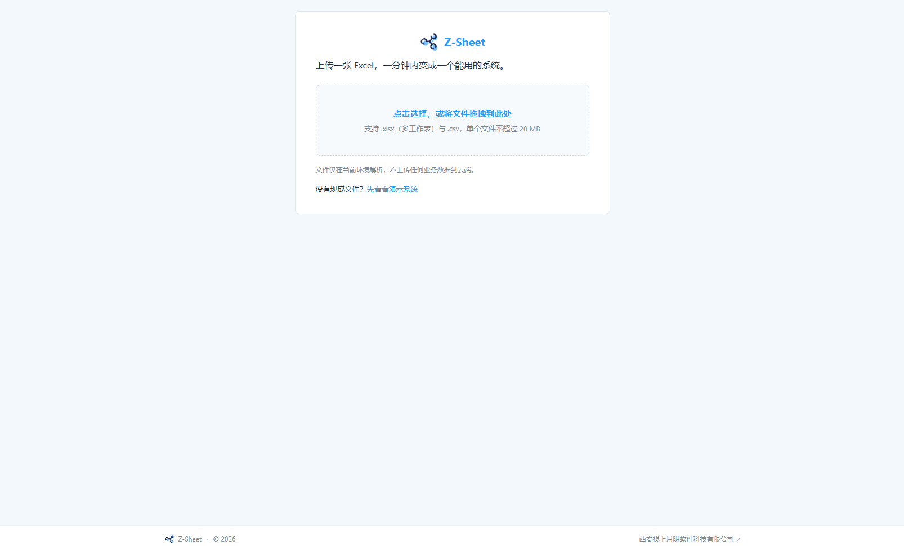
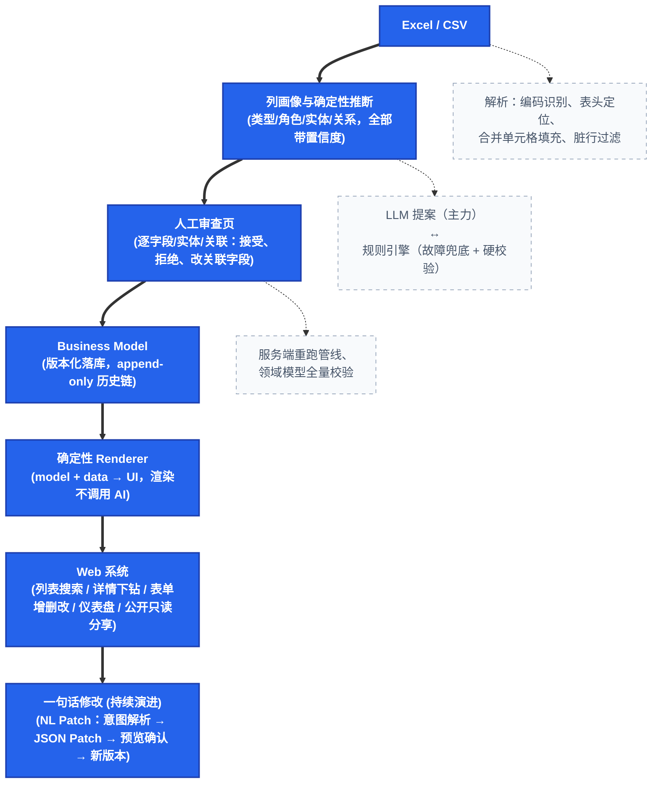
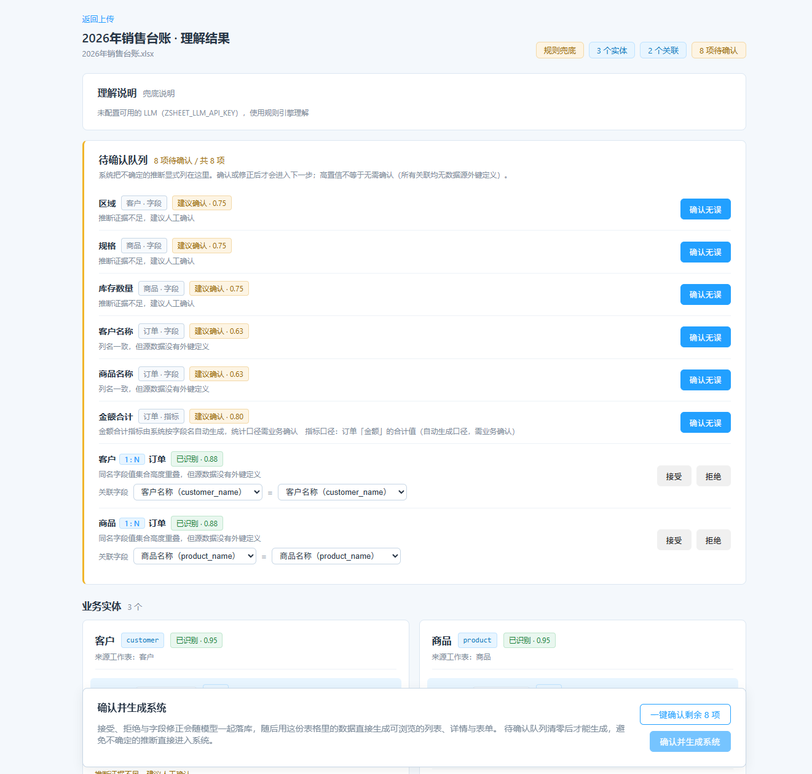
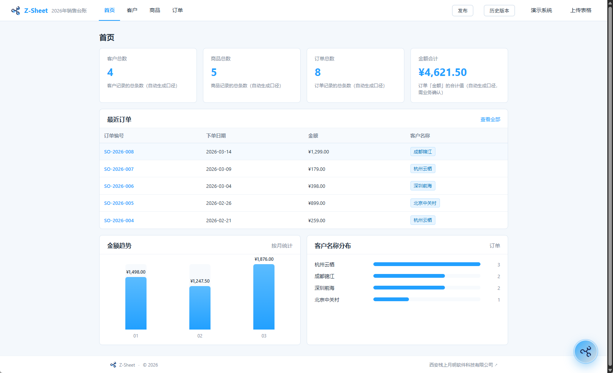
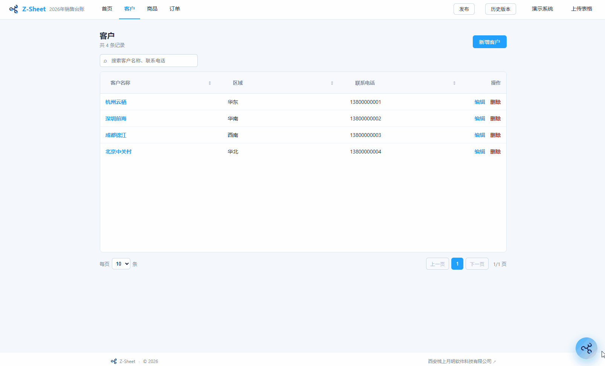

<p align="center">
  
</p>

<h1 align="center">Z-Sheet</h1>

<p align="center">
  <strong>AI 只写模型，不写代码。所以这套系统你改得动、带得走。</strong>
</p>

<p align="center">
  拖进一份 Excel/CSV，AI 读懂表头与字段关系，你逐项确认，<br/>
  几分钟后长出一套带真实数据的 Web 系统：列表、详情、表单、看板。
</p>
<p align="center">
  
</p>


<p align="center">
  <a href="https://zsoftym.com/">官网</a>
  &nbsp;·&nbsp;
  <a href="./CHANGELOG.md">更新日志</a>
  &nbsp;·&nbsp;
  <a href="#后续规划">后续规划</a>
  &nbsp;·&nbsp;
  <a href="./CONTRIBUTING.md">参与贡献</a>
  &nbsp;·&nbsp;
  <a href="#快速开始docker推荐">快速开始</a>
</p>

<p align="center">
  
  
  
</p>

> **0.1.0-alpha.2 实验性版本** · 核心闭环（Excel → AI 理解 → 人工审查 → 可用系统 → 一句话修改）已跑通 · 面向早期试用者，接口与界面仍可能调整 · 详见 [CHANGELOG.md](./CHANGELOG.md)

---

## 这是什么

每个团队的电脑里都躺着大量 Excel：客户跟进表、销售台账、库存表、人员登记表……它们承载着真实业务，却被困在文件里——没法检索、没法协作、没有关联视图、数据散落在各个版本的附件中。

**Z-Sheet 让表格跨过这道门槛。** 上传文件后，系统会读懂表头与数据：哪列是日期、哪列是金额、哪列是分类、哪些表之间存在一对多关系。理解结果以**业务模型（Business Model）**呈现给你逐项审查；确认之后，同一个模型立刻渲染出列表、详情、表单和仪表盘，数据原样入库，开箱即用。后续要调整，说一句中文就行：「给客户表加一个手机号字段」「把订单表的状态改成枚举」，改动可预览、可撤销、可回到任意历史版本。

它解决的是**第一天就有数据**这件事：系统不是空壳，生成出来就长在你的真实表格上。

适合两类场景：

- **业务人员自助数字化**：不懂代码，也能把手中的台账变成团队可用的系统；
- **开发者/交付团队快速起步**：用 AI 完成从原始数据到可运行原型的最耗时的一段，模型文件可读可改可接管。

## 工作原理



这条链路上有三条硬约定：

- **理解与渲染分离**：AI 只产模型（结构化、可校验），Renderer 是纯函数式的 `model + data → UI`，永不调用模型；
- **规则引擎双重身份**：无 LLM 时作为兜底产出理解结果；有 LLM 时作为提案的硬校验器与故障兜底；
- **版本化一切**：模型与补丁均为 append-only 记录，回滚靠"追加一个等于历史快照的新版本"实现，历史不可篡改。

第 1 条还有一层保护：类型推断、实体识别、关系推断全部带置信度，没有外键定义佐证的关联和低置信度字段一律进入审查队列等你拍板，而不是静默猜错。确认时服务端重跑整条管线，浏览器只提交「接受 / 拒绝」决策，无法篡改模型内容。

## 为什么是 Z-Sheet

**1. 模型是唯一事实来源，渲染完全确定。**

AI 只负责产出结构化模型（Pydantic 校验的 JSON），绝不直接生成界面代码。界面由确定性渲染器依据「模型 + 数据」生成：同一份模型，任何时候渲染结果一致，可复现、可测试、不会因为模型"心情不同"给出不同系统。

LLM 超时、限流、返回坏内容时会自动重试，重试耗尽才降级为内置规则引擎——理解与生成流程不中断。

**2. 对真实脏数据有耐心。**

GBK/UTF-16 编码、分隔符自动识别、合并单元格向下填充、合计行/注释行过滤、`not provided` / `missing: lab stock` 这类科学元数据标准缺失值标记——真实世界表格里的常见瑕疵都有确定性处理规则，而不是遇到一个报一次错。

**3. 改一句中文就能改系统，而且可撤销。**

加字段、删字段、改类型、实体改名，说一句就行。系统把它解析成结构化意图，生成 JSON Patch 和一份确定性的中文变更说明，预览确认后才落库；改错了可以 undo 撤销，也能 rollback 回任意历史版本。版本链是 append-only 的，历史从不改写。

## 和传统管理软件、低代码平台有什么不同

传统管理软件（CRM、ERP 这类）走的是成熟但偏重的路径：选型 → 实施顾问调研 → 配置或二次开发 → 培训 → 迁移历史数据，适合组织规模大、流程复杂、需要严格管控的场景。低代码平台更灵活，但需要有人先学明白平台自身的概念与配置。

Z-Sheet 走的是另一条更轻的路径：**你手里那份已经用了很久的 Excel 就是起点**——几分钟变成一套带真实数据的系统，之后用一句话持续演进。它不替代前两者，面向的是更前面、也更常见的那一段：还没有系统，或者现有系统已经跟不上业务变化。

| 维度 | 传统管理软件（CRM / ERP 等 SaaS） | 低代码平台 | Z-Sheet |
| --- | --- | --- | --- |
| 上线方式 | 选型、实施、培训，数周到数月 | 懂平台的人拖拽搭建 | 上传 Excel/CSV，分钟级出系统 |
| 首批数据 | 空系统，重新录入或付费迁移 | 空模块，自己填 | 表格数据直接入库，第一天就真实 |
| 后续变更 | 提需求、排期，常按人天收费 | 自己改，但要懂平台概念 | 说一句中文，预览确认后生效 |
| 数据归属 | 多在厂商云端 | 多在平台云端 | 自有服务器，本地 SQLite 卷 |
| 成本 | 账号年费 + 实施服务费 | 平台订阅费 + 搭建人力 | AGPL-3.0 开源，自托管无账号费 |

**数据自主**：单容器部署（FastAPI 同时提供 API 和前端），数据落在本地 SQLite 卷；支持完全离线的本地大模型，数据不出内网。代码以 AGPL-3.0 开源，没有锁定，没有黑盒。

**边界也要讲清楚**：Z-Sheet 不打算取代成熟的管理软件——多用户权限体系、审批/工作流/通知、复杂 BI 工作台是后续版本的明确规划。它解决的是更前面、也更普遍的一段路：**一份真实表格 → 团队当天就能用的系统**，而且这套系统不归任何厂商或平台所有。

## 界面预览

​                                                     




​                                                     

## 当前能力（0.1.0-alpha.2）

想先跑起来的直接跳到[快速开始](#快速开始docker推荐)；以下是逐项能力，方便评估。

<details>
<summary>展开完整能力清单</summary>
**从文件到系统**

- `.xlsx`（多 Sheet）/ `.csv` 解析：表头行自动定位，UTF-8（含 BOM）/UTF-16/GB18030 编码兼容，逗号/Tab/分号分隔符自动识别，20 MB / 单表 5 万行 / 200 列上限，超限返回可读错误
- 脏数据治理：纵向合并单元格向下填充并清除格内换行、合计/小计行与表尾注释行过滤、标准缺失值标记识别（中英文词表与 `missing: 原因` / `Not applicable (说明)` 结构）
- 列画像（空值率、distinct/唯一/重复、高频值、确定性等距采样）与六类字段类型推断（string / number / money / date / enum / phone）、六类语义角色推断，全部带置信度与待确认标记
- 实体识别与一对多关系推断：四重证据 + 四档置信度，无外键定义的关联一律进人工审查
- 上传页 SSE 分阶段真实进度；审查页逐字段/实体/关联处理（接受、拒绝、改关联字段、一键确认剩余项）
- Confirm 全链路：服务端重跑管线（不采信客户端推断）→ 决策重组模型 → 领域全量校验 → 版本落库 → 数据按类型规整入库，业务异常一律返回可读的 422

**AI 理解层（OpenAI 兼容）**

- 统一 Provider：默认 DeepSeek 公有云，环境变量一键切换 Ollama / vLLM 等本地引擎（本地引擎无需 Key）
- LLM 提案经真实工作表硬校验：列必须存在、类型/关系必须合法，漏列自动回退规则推断，非法/低置信项进审查队列
- 韧性设计：超时分类、5xx/429/坏输出小预算自动重试（`ZSHEET_LLM_MAX_RETRIES`），重试耗尽才降级规则引擎；日志中的 API Key 一律掩码

**生成的应用（确定性 Renderer）**

- List：跨字段搜索（多词 AND、中英端子串）、多选过滤（含空桶）、三态排序、固定布局分页
- Detail：字段详情 + 一对多关联列表，可下钻子记录
- Form / CRUD：类型化表单、必填与前后端校验、业务键编辑锁定
- Dashboard：指标卡、月度趋势、枚举分布（指标口径由理解阶段生成并经人工确认，零图表库依赖）
- 公开只读分享：自定义链接、钉住模型版本、业务数据实时可见、无写权限，下线后旧链接立即失效

**自然语言修改（NL Patch）**

- 一句话修改系统：加/删/改字段、实体改名等高风险操作生成结构化意图与确定性中文变更说明
- 预览 → 确认/拒绝的防篡改会话（补丁不出服务端、1 小时过期、版本冲突返回 409）
- 撤销与回滚：undo 撤销最新修改，rollback 回到任意历史版本；版本链 append-only，历史从不改写

**交付与运维**

- 单容器（FastAPI 同时提供 API 与构建后的 SPA）、Alembic 自动迁移、SQLite 数据卷、容器健康检查与自动重启
- 内置演示系统（销售管理）与 10 份真实感演示数据集（`examples/demo_data/`，覆盖销售、库存、客户跟进、人员登记、采购、固定资产、项目、生产、人事、物流）

</details>

## 后续规划

先把「一份真实表格 → 一个可用系统」这条闭环做深做稳，再逐步扩大边界。下面四条按优先级排列，先做前两条。

- **稳定性与易用性**：继续加固真实脏表格的解析与导入体验，让非开发者也敢独立安装、导入、生成与修改；
- **从「一个表格」到「一个小业务」**：多文件导入，以及给已经在跑的系统继续追加新表格、用一句话新增功能模块；更复杂关系的处理与导入冲突消解，配套基础用户体系、分享链接、审计日志与关系编辑（底座数据存储切换至 PostgreSQL，以支撑多人并发协作与更大数据量）；
- **AI 更进一步**：自然语言查询与指标问答、结果可追溯到来源，以及异常检测与主动业务简报；
- **运行时化**：让 Business Model + Renderer + AI Patch 沉淀为稳定的应用运行时，对外提供 API / 嵌入 / 导入导出能力。

完成情况一律如实记录在 [CHANGELOG.md](./CHANGELOG.md)；优先级遵循一条原则：先让真实表格稳定闭环，再扩大边界。欢迎通过 Issue 提出你希望优先解决的方向。

## 快速开始（Docker，推荐）

前置：已安装 Docker（含 Compose 插件）。Windows / macOS 用 Docker Desktop，Linux 用 Docker Engine + Compose。

**1. 配置 LLM（推荐）**

```bash
cp .env.example .env
# 编辑 .env：
#   - 有 DeepSeek Key：直接填 ZSHEET_LLM_API_KEY 即可（默认已是云端配置）
#   - 想用本地 Ollama：改 BASE_URL / MODEL，API_KEY 留空（详见 .env 内注释）
#   - 不配置 LLM：跳过本步，系统以规则引擎运行（只覆盖典型台账表格，能力有限，正式使用请配置模型）
```

**2. 构建并启动**

```bash
docker compose up -d --build
```

打开 <http://localhost:8000> 。容器启动时自动执行数据库迁移；首次打开应用时会自动导入内置演示系统（客户 / 订单），也可以直接上传自己的 Excel。

健康检查：`GET http://localhost:8000/api/v1/health`（返回版本号与数据库状态）。

停止命令；加 `-v` 同时清空数据卷：

```bash
docker compose down        # 停止，保留数据
docker compose down -v     # 停止并清空全部数据
```

> Linux 使用本地引擎：容器内访问宿主机的 Ollama 统一用 `host.docker.internal`（需 Compose v2.3+ 或添加 `--add-host`），并注意 Ollama 默认只监听 127.0.0.1。

## 本地开发

环境要求：Python 3.12（最低 3.11）、[uv](https://docs.astral.sh/uv/)、Node 24、pnpm 12，Windows / Linux / macOS 均可开发。

后端（:8000）：

```bash
uv sync
uv run alembic upgrade head
uv run uvicorn backend.api.main:app --reload
```

前端（:5173，`/api` 已代理到 :8000；5173 被占用时 Vite 自动改用 5174，仍走代理）：

```bash
cd frontend
pnpm install
pnpm dev
```

打开 <http://localhost:5173> 。LLM 配置通过仓库根目录的 `.env`（或 `ZSHEET_*` 环境变量）生效；不配置即规则引擎模式（说明见[快速开始](#快速开始docker推荐)），离线测试在此模式运行。

## 环境变量

所有变量均可选；不配置任何 LLM 变量时以规则引擎运行（说明见[快速开始](#快速开始docker推荐)）。

| 变量 | 默认值 | 说明 |
| --- | --- | --- |
| `ZSHEET_LLM_BASE_URL` | `https://api.deepseek.com` | OpenAI 兼容接口地址（`/chat/completions`） |
| `ZSHEET_LLM_MODEL` | `deepseek-flash` | 模型名（Ollama 如 `qwen2.5:7b`） |
| `ZSHEET_LLM_API_KEY` | _空_ | API Key；本地引擎留空，留空且为云端地址时不调用 LLM |
| `ZSHEET_LLM_TIMEOUT` | `60` | 单次请求超时秒数 |
| `ZSHEET_LLM_MAX_RETRIES` | `1` | 失败后额外重试次数（0 = 不重试） |
| `ZSHEET_LLM_ENABLE_THINKING` | `true` | 仅 DeepSeek 官方端点发送 thinking 参数 |
| `ZSHEET_LOG_LEVEL` | `INFO` | 日志级别（DEBUG/INFO/WARNING/ERROR） |
| `ZSHEET_DATA_DIR` | `./data` | SQLite 与数据目录（容器内固定 `/app/data`） |
| `ZSHEET_CORS_ORIGINS` | 本地 5173 | JSON 数组，允许跨域访问 API 的来源 |

## 架构

**技术栈**

- 后端：Python 3.12 · FastAPI · Pydantic v2 · SQLAlchemy 2 · Alembic · SQLite
- 前端：React · TypeScript · Vite · TanStack Query/Table · React Hook Form
- AI：自研 Provider 抽象层，兼容 OpenAI 协议，公有云 / 本地引擎可切换
- 形态：模块化单体（Modular Monolith），单容器交付，无外部中间件依赖

**分层与数据流**

```text
┌─────────────────────────── 前端（确定性 Renderer） ─────────────────────────────┐
│  UploadPage → UnderstandingPage（审查） → AppLayout：List / Detail / Form /     │
│  Dashboard / PublicAppLayout（公开只读）        PatchDialog（一句话修改悬浮球） │
└──────────────────────────────────┬──────────────────────────────────────────────┘
                                    │ HTTP / SSE
┌──────────────────────────────────▼──────────────────────────────────────────────┐
│  backend/api                路由：解析(SSE) / 理解确认 / 模型版本 / Patch /     │
│                             运行时数据 / 公开发布 / 健康检查                    │
├─────────────────────────────────────────────────────────────────────────────────┤
│  backend/understanding       理解管线（纯确定性 + 可选 LLM）                    │
│    ingestion.parser         解析（编码、表头、合并单元格、脏行、缺失值标记）    │
│    profiling                列画像                                              │
│    type_inference           类型/置信度推断                                     │
│    entity / relation        实体与一对多关系推断                                │
│    llm_understanding        LLM 提案 + 真实数据硬校验                           │
│    confirmation             服务端重跑、人工决策、领域校验、入库                │
├─────────────────────────────────────────────────────────────────────────────────┤
│  backend/domain             Business Model / Patch 领域模型（唯一事实来源）     │
│  backend/patch              NL 意图解析 + RFC 6902 子集确定性应用器             │
│  backend/runtime           model + data 运行时引导                              │
│  backend/storage           SQLAlchemy 模型、版本化仓储、app_data                │
└─────────────────────────────────────────────────────────────────────────────────┘
```

**代码结构**

```text
backend/ai              OpenAI 兼容 LLM Provider（超时分类、重试、Key 掩码）
backend/domain          Business Model 与 Patch 的领域定义、序列化
backend/ingestion       Excel/CSV 解析与脏数据治理
backend/understanding   理解管线：画像 → 类型 → 角色 → 实体 → 关系 → LLM 校验 → 组装
backend/patch           RFC 6902 子集确定性 Patch 应用器 + NL 意图解析/生成
backend/storage         SQLAlchemy 模型、仓储（模型版本与 app_data 运行时数据）
backend/runtime         渲染运行时引导（model + data）
backend/api             FastAPI 路由（解析 / 确认 / 模型管理 / Patch / 运行时 / 发布）
migrations              Alembic 迁移
frontend/src/renderer   类型驱动的确定性渲染（View Resolver + 视图组件）
examples                演示模型、种子数据与 10 份演示 Excel 数据集
docker                  镜像与入口脚本
```

## 检查与测试

```bash
# 后端
uv run ruff check .
uv run pyright
uv run pytest

# 前端
cd frontend
pnpm test
pnpm lint
pnpm build
```

## 参与贡献

欢迎 Issue 与 PR，请先阅读 [CONTRIBUTING.md](./CONTRIBUTING.md)；提交前请确保后端三件套（ruff / pyright / pytest）与前端检查（lint / test / build）通过。后续方向见[后续规划](#后续规划)。

## 关于我们

Z-Sheet 由 **[西安栈上月明软件科技有限公司](https://zsoftym.com/)** 开发与维护，官网：<https://zsoftym.com/> 。

## 许可证

[GNU Affero General Public License v3.0](./LICENSE)（AGPL-3.0）。网络服务同样受 Copyleft 约束：通过网络提供服务时，修改后的源代码也需向使用者开放。
